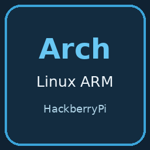

# Arch Linux ARM Xfce for HackberryPi

Customized ARM64 **Arch Linux ARM** with **Xfce/X11** for **HackberryPi CM5**, including genuine **Neofetch 7.1.0**.

Arch Linux ARM is a community ARM distribution. The main [Arch Linux distribution](https://archlinux.org/about/) targets x86-64; this image uses [Arch Linux ARM](https://archlinuxarm.org/) packages and a native BCM2712 kernel.

- Default **900 × 900** workspace on the native **720 × 720** screen.
- English **Display Scale** desktop app, adjustable from **480 × 480** to **1080 × 1080**, with font antialiasing.
- HackberryPi DPI screen, direct touchscreen and MAX17048 battery integration, including the Xfce battery indicator.
- Login-screen hint: **Default Password: pi**.
- Native NetworkManager Wi-Fi, Bluetooth pairing controls and PipeWire audio components.
- Original upstream **Neofetch 7.1.0**, installed as a normal `neofetch` package. Open a terminal and run `neofetch`.
- Automatic screensaver, screen blanking, DPMS, idle dimming and idle suspend disabled on AC and battery. Manual locking and password-based login remain available.

Default username: **pi**. Default password: **pi**. Both are lowercase. Use `sudo` for administrator commands and change the password after first login. Configure your own Wi-Fi and application accounts; the public image has no saved personal network credentials.

## Raspberry Pi Imager

Use the [Imager online catalog](https://raw.githubusercontent.com/DZT970525/Operating-System-for-HackberryPi/main/os_list_imager.json) and select **HackberryPi CM5 → Arch Linux ARM Xfce for HackberryPi**, or [download the complete image](https://github.com/DZT970525/Operating-System-for-HackberryPi/releases/download/archlinux-displayscale-hackberrypi-2026-11-12/ArchLinux-ARM-Xfce-HackberryPi-CM5-DisplayScale-Neofetch-20261112.img.xz) and choose **Use custom**. Select the compressed `.img.xz` directly; manual decompression and merging are not needed.

Use a **16 GB or larger SD card**. Writing replaces the selected card. Let Imager finish writing and verification, then insert the card in HackberryPi CM5 and boot. See the [installation guide](../Imager/Arch.md).

## Display Scale and screen-idle defaults

Double-click **Display Scale** on the desktop, drag the slider and release to apply. **Save as default** remembers a selection; **Reset to 900** restores the factory workspace.

The physical screen stays **720 × 720 pixels**. Smaller workspace values enlarge text and controls; larger values fit more content. The **480–1080** range changes software scaling. No desktop pinch-to-zoom service is included.

Automatic idle display transitions are disabled to keep the DPI screen on. Manual locking remains available. The login hint describes the factory password; use your new password after changing it.

## First start and updates

Each installation creates a fresh machine identity and SSH host keys. Personal Wi-Fi profiles, Bluetooth pairings, application sessions and histories are excluded from the public image. First-start preparation also initializes the native package trust database; allow it to finish before updating packages.

Standalone root expansion: **passed in a disposable two-partition loop test, including identity refusal, online ext4 growth and deferred-refresh resume; physical first boot remains untested**.

The native kernel is **6.18.60-1-rpi-16k**, packaged by Arch Linux ARM as `linux-rpi-16k 6.18.60-1`. Its matching headers are included. Hardware kernel updates require matching kernel/header packages and a successful battery-module and native boot refresh. Keep the system coherent with full `sudo pacman -Syu` upgrades. The stock generic Arch Linux ARM root filesystem alone does not establish HackberryPi CM5 display support.

Neofetch is the original upstream script, locally packaged from commit `60d07dee6b76769d8c487a40639fb7b5a1a7bc85`. It is not a renamed alternative. Its source and MIT license are retained in the source bundle.

## Validation

The owner accepted the configured source card for publication. Physical boot of the source card was not independently confirmed during this preparation. The release is prepared from that configuration after removing personal state.

- Factory privacy and offline audit: **passed: fresh filesystems, private state excluded before capture, factory account and residual audit verified**.
- Compressed-image and expanded-image verification: **passed: native filesystem/offline checks and complete compressed-to-raw SHA-256 round-trip**.
- First-boot standalone filesystem expansion: **passed in a disposable two-partition loop test, including identity refusal, online ext4 growth and deferred-refresh resume; physical first boot remains untested**.
- Physical boot of the final sanitized image: **not performed; a separate physical flash/boot test remains pending**.
- Separate AC/battery idle-display and manual-lock test: **not performed; native configuration checked, separate physical testing remains pending**.

Source-card acceptance and offline/loop checks do not establish a physical first boot of a newly flashed factory image.

## Checksums

| Artifact | Bytes | SHA-256 |
| --- | --- | --- |
| `ArchLinux-ARM-Xfce-HackberryPi-CM5-DisplayScale-Neofetch-20261112.img.xz` | `1156947144` | `89f459f4b0f68db1f0530a20bf660888435252a1ad5fa27cf51247760ed0ea21` |
| Expanded `.img` | `5421137920` | `ede076ba6997c538ea23b6a118dc51588d9d6e90e2eeacd54c55ea99db120506` |

Release: [archlinux-displayscale-hackberrypi-2026-11-12](https://github.com/DZT970525/Operating-System-for-HackberryPi/releases/tag/archlinux-displayscale-hackberrypi-2026-11-12). `SHA256SUMS`, `factory-status.json` and the local verification report `image-verification.json` accompany the image.

## PINN

This release is a **standalone Raspberry Pi Imager image**. It has no Arch PINN entry or tested PINN partition adapter. The six existing PINN systems retain their current installation method. A complete `.img.xz` is not a PINN filesystem archive.

## Sources and notices

The [integration source](https://github.com/DZT970525/Operating-System-for-HackberryPi/releases/download/archlinux-displayscale-hackberrypi-2026-11-12/ArchLinux-HackberryPi-Integration-Source-20261112.tar.gz) contains the actual battery module, screen/touch overlay source, native boot helper, Display Scale app, no-idle settings, standalone growth helper and pinned Neofetch source. [Source and license notices](https://github.com/DZT970525/Operating-System-for-HackberryPi/releases/download/archlinux-displayscale-hackberrypi-2026-11-12/ArchLinux-HackberryPi-Source-Notices-20261112.tar.gz) preserve component provenance, license notices and the exact Arch Linux ARM kernel build recipe and patches.

The complete matching [Raspberry Pi Linux source archive](https://github.com/DZT970525/Operating-System-for-HackberryPi/releases/download/archlinux-displayscale-hackberrypi-2026-11-12/Linux-RPi-6.18.60-ArchLinuxARM-Source-20261112.tar.gz) is attached separately; its SHA-256 is `42dc59c7e4d22288d1fcfc833f1b8227cee6dbec8ebed3ad5dd78ed150ee9145`. The supplied Arch Linux ARM recipe and patches pin this archive to upstream commit `a4985478de14b3a83c8e04fed68377c1bdae735d`.

Native package copyrights and licenses remain in the installed system. This independently maintained customization is not an official release of the Arch Linux or Arch Linux ARM projects.
