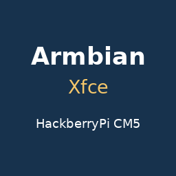

# Armbian Xfce for HackberryPi

Customized ARM64 **Armbian 26.8.1 / Debian 13 Trixie** with a preinstalled **Xfce/X11** desktop for **HackberryPi CM5**.

- Preinstalled **Xfce/X11** desktop with LightDM password login.
- Default **900 × 900** workspace on the physical **720 × 720** DPI screen.
- English **Display Scale** desktop app for **480 × 480–1080 × 1080**, with font antialiasing.
- HackberryPi screen, direct touchscreen, **MAX17048 battery** and **USB 2.0 Host** support.
- Top-right **Wi-Fi, Bluetooth, volume, battery and clock** controls, using native NetworkManager, BlueZ/Blueman and PipeWire.
- Original **Neofetch 7.1.0**; run `neofetch` in a terminal.
- Login hint **Default Password: pi**. Default username and password are **pi / pi**, both lowercase.
- Automatic screensaver, blanking, DPMS, idle dimming and idle suspend disabled on AC and battery. Manual locking remains available.

Use `sudo` for administrator commands and change the factory password after first login. Configure your own Wi-Fi, Bluetooth and application accounts; the public copy excludes saved private connections, pairings, sessions and histories.

## Raspberry Pi Imager

Choose **HackberryPi CM5 → Armbian Xfce for HackberryPi** in the [Imager online catalog](https://raw.githubusercontent.com/DZT970525/Operating-System-for-HackberryPi/main/os_list_imager.json), or [download the complete image](https://github.com/DZT970525/Operating-System-for-HackberryPi/releases/download/armbian-displayscale-hackberrypi-2026-11-13/Armbian-26.8.1-Xfce-HackberryPi-CM5-DisplayScale-Neofetch-20261113.img.xz) and select it with **Use custom**. Select the compressed `.img.xz` directly; no manual merging or decompression is needed.

Use a **16 GB or larger SD card**. Writing replaces the selected card. Wait for writing and verification, then insert the card in HackberryPi CM5 and boot. Read the [installation guide](../Imager/Armbian.md).

## Display Scale and desktop controls

The physical panel stays **720 × 720 pixels**. Display Scale changes the software workspace: smaller numbers enlarge text and controls; larger numbers fit more content. Double-click **Display Scale** on the desktop, choose **480–1080**, and use **Save as default** to retain a setting. **Reset to 900** restores the factory workspace. No global desktop pinch-to-zoom service is included.

Use the top-right panel's Wi-Fi icon to select a network, Bluetooth icon for discovery and pairing, and volume icon for sound controls. NetworkManager manages Wi-Fi/Ethernet and passes DHCP DNS to native systemd-resolved. Bluetooth uses the native CM5 firmware and UART mechanism.

## First start and maintenance

First-start preparation expands the compact image and creates fresh machine/SSH identities. Xfce is preinstalled, and the factory interactive root-login wizard is disabled after preparing the ordinary `pi` account.

The native Armbian kernel, device-tree and header packages are the coherent **26.8.3** bundle for **6.18.44-current-bcm2711**. Keep all three packages and matching headers coherent when updating through Armbian/APT. The MAX17048 driver uses DKMS; a new kernel needs a successful module build. Native Armbian boot hooks are retained, with a late hook restoring the custom screen overlay after native kernel updates. No foreign distribution's kernel is substituted.

## Validation

The owner accepted the configured source card for publication. Factory privacy audit: **passed: fresh filesystems, private state excluded and factory account retained**. Native filesystem and offline integration audit: **passed: native filesystem, startup, display and network integration checks**. Complete compressed-to-raw verification: **passed: complete XZ integrity and compressed-to-raw SHA-256 round-trip**. Standalone root expansion: **passed using the shipped helper in an isolated two-partition loop test; physical first boot remains pending**.

The rebuilt sanitized release image has not received a separate physical flash/first-boot test. Actual Wi-Fi association, Bluetooth pairing, audio playback, screen/touch behavior and AC/battery idle/manual-lock behavior require that final-image device test.

## Checksums

| Artifact | Bytes | SHA-256 |
| --- | --- | --- |
| `Armbian-26.8.1-Xfce-HackberryPi-CM5-DisplayScale-Neofetch-20261113.img.xz` | `641406348` | `6620fd62e16a4e9b97f59cf786f324b6360f1f637602b9bb35cbae60724a595d` |
| Expanded `.img` | `4601151488` | `5e798c068776fed175e51326fae76714822ba444bdeb14d7390e6072ed10fc07` |

Release: [armbian-displayscale-hackberrypi-2026-11-13](https://github.com/DZT970525/Operating-System-for-HackberryPi/releases/tag/armbian-displayscale-hackberrypi-2026-11-13). `SHA256SUMS`, `factory-status.json` and `image-verification.json` accompany the image.

## PINN

This release is **standalone for Raspberry Pi Imager**. It has no Armbian PINN filesystem package or tested multiboot adapter. The existing PINN feed and other systems are preserved. A complete disk `.img.xz` is not a PINN partition archive.

## Sources and notices

The [integration source archive](https://github.com/DZT970525/Operating-System-for-HackberryPi/releases/download/armbian-displayscale-hackberrypi-2026-11-13/Armbian-HackberryPi-Integration-Source-20261113.tar.gz) includes the actual screen/touch overlay source, modified MAX17048 driver and DKMS files, Display Scale code and configuration, original pinned Neofetch source, and the standalone factory helpers shipped with this image. The [source-notices archive](https://github.com/DZT970525/Operating-System-for-HackberryPi/releases/download/armbian-displayscale-hackberrypi-2026-11-13/Armbian-HackberryPi-Source-Notices-20261113.tar.gz) retains upstream licenses, official base-image authentication evidence and the native package/source inventory.

The matching native Armbian **26.8.3** kernel source components for **6.18.44-current-bcm2711** are attached to this Release:

- [RaspberryPi-Linux-6.18.44-59abfb50f1dfdc3c51bce3f2020ce3ae0dc8eaa0.tar.gz](https://github.com/DZT970525/Operating-System-for-HackberryPi/releases/download/armbian-displayscale-hackberrypi-2026-11-13/RaspberryPi-Linux-6.18.44-59abfb50f1dfdc3c51bce3f2020ce3ae0dc8eaa0.tar.gz). SHA-256: `d988b98be878e7bac904e3f5db47030162475865edecb0a7e1f9da98291417d0`.
- [Armbian-Build-fd4ebfd1e107d5b89f7a672c7d609789565753b2.tar.gz](https://github.com/DZT970525/Operating-System-for-HackberryPi/releases/download/armbian-displayscale-hackberrypi-2026-11-13/Armbian-Build-fd4ebfd1e107d5b89f7a672c7d609789565753b2.tar.gz). SHA-256: `2159f01d54e26d0517fb1a7f15b1024b6c320e95c0423045aec661fc0fbf27b9`.
- [Armbian-6.18.44-current-bcm2711.config](https://github.com/DZT970525/Operating-System-for-HackberryPi/releases/download/armbian-displayscale-hackberrypi-2026-11-13/Armbian-6.18.44-current-bcm2711.config). SHA-256: `34c94413da16ed50e7485f5edfcd64cfd4e7357d4f203ea423a67de785c29fdb`.
- [Armbian-6.18.44-Source-Reconstruction.md](https://github.com/DZT970525/Operating-System-for-HackberryPi/releases/download/armbian-displayscale-hackberrypi-2026-11-13/Armbian-6.18.44-Source-Reconstruction.md). SHA-256: `ea12b820ccf422e29acb626cbacdc60192ba76d625a54a2037f9eb90f17b88ec`.
- [Armbian-6.18.44-Source-Provenance.json](https://github.com/DZT970525/Operating-System-for-HackberryPi/releases/download/armbian-displayscale-hackberrypi-2026-11-13/Armbian-6.18.44-Source-Provenance.json). SHA-256: `652930b2b55b3e43395a63c4b1082da894af391fab71c66b75447f6f1ac39126`.

Together these retain the pinned Raspberry Pi kernel base, matching Armbian build framework and patch material, and final configuration identified by the authenticated native package provenance. Read the attached source/build provenance notes for component boundaries and reconstruction details; the kernel-base archive alone is not the complete patched Armbian source.

Native package copyrights remain under `/usr/share/doc`. This is an independently maintained HackberryPi customization based on [Armbian](https://www.armbian.com/) and [Debian](https://www.debian.org/), not an official Armbian image. Upstream names identify the included software; no project endorsement is claimed.
