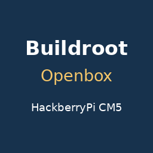

# Buildroot for HackberryPi

This is an independently prepared **Buildroot 2026.08.1** ARM64 userspace with a preinstalled **Openbox/X11** desktop for **HackberryPi CM5**. It uses the matching Raspberry Pi/Armbian **6.18.44-current-bcm2711** kernel, device trees, modules and firmware as its board-support layer. The userspace is built by Buildroot; an Armbian/Debian root filesystem is not substituted.

Buildroot is an embedded-system build framework. This image does not provide APT, pacman or a full distribution package manager. Add or update system packages by rebuilding the supplied Buildroot configuration and integration sources. Dillo is a lightweight browser without JavaScript support.

- Preinstalled **Openbox/X11** desktop with a lightweight Tcl/Tk shell and XDM password login.
- Default **900 × 900** workspace on the physical **720 × 720** DPI screen.
- English **Display Scale** launcher at the bottom-right of the desktop, with a **480 × 480–1080 × 1080** slider and font antialiasing.
- HackberryPi screen/touch, **MAX17048 battery**, and **USB 2.0 Host** integration.
- Top-right Wi-Fi, Bluetooth, volume, battery and clock controls. Wi-Fi uses **NetworkManager/nmtui**, Bluetooth opens its pairing console, and sound opens **alsamixer**.
- Genuine **Neofetch 7.1.0**; run `neofetch` in a terminal.
- Login hint **Default Password: pi**. Username and password: **pi / pi**, both lowercase.
- Automatic X11 screen blanking and DPMS disabled; no screensaver or global desktop pinch-to-zoom service is installed.

Change the factory password after first login and use `sudo` for administrator commands.

## Raspberry Pi Imager

Choose **HackberryPi CM5 → Buildroot Openbox for HackberryPi** in the [Imager online catalog](https://raw.githubusercontent.com/DZT970525/Operating-System-for-HackberryPi/main/os_list_imager.json), or [download the complete image](https://github.com/DZT970525/Operating-System-for-HackberryPi/releases/download/buildroot-displayscale-hackberrypi-2026-11-15/Buildroot-2026.08.1-Openbox-HackberryPi-CM5-DisplayScale-Neofetch-20261115.img.xz) and select it with **Use custom**. Select the compressed `.img.xz` directly; merging and manual decompression are not needed.

Use a **16 GB or larger SD card**. Writing replaces the selected card. Wait for writing and verification, then insert the card in HackberryPi CM5 and boot. Keep the factory account and use the running desktop for Wi-Fi setup; Imager OS customization is not provided. Read the [installation guide](../Imager/Buildroot.md).

## Display Scale and desktop controls

The physical panel stays **720 × 720 pixels**. Display Scale changes the software workspace: smaller numbers enlarge text and controls; larger numbers fit more content. Open **Display Scale** at the bottom-right of the desktop, select **480–1080**, and release the slider to apply. **Save as default** retains a setting; **Reset to 900** restores the factory workspace. The desktop launcher and ordinary windows are repositioned to stay reachable when the workspace shrinks.

Use the top-right Wi-Fi control to choose your own network in nmtui. The Bluetooth control opens a terminal with pairing instructions; its interface is not a graphical Bluetooth settings page. Volume opens alsamixer. The desktop right-click menu opens the installed terminal, Dillo browser, Display Scale and Neofetch.

## First start and maintenance

The compact image starts with a **2 GiB root filesystem**. It does not automatically expand to fill a larger SD card. Additional space can be allocated by expanding the root partition and ext4 filesystem offline on Linux, preserving its start sector and PARTUUID.

Saved Wi-Fi credentials, Bluetooth pairings, private home files, sessions, identities and diagnostic histories are excluded from the public copy; the factory pi account and default 900 workspace are retained.

## Validation

The owner accepted the configured source card for publication. Saved Wi-Fi credentials, Bluetooth pairings, private home files, sessions, identities and diagnostic histories are excluded from the public copy; the factory pi account and default 900 workspace are retained. Fresh FAT/ext4 filesystem checks, preservation of public runtime payloads, factory privacy checks, and complete compressed-to-raw SHA-256 verification passed.

The freshly sanitized and repackaged release image has not received a separate physical flash/first-boot test. Physical screen/touch, USB keyboard, Wi-Fi association and Internet access, Bluetooth pairing, battery readings and audio on that release image remain part of the final-device test.

## Checksums

| Artifact | Bytes | SHA-256 |
| --- | --- | --- |
| `Buildroot-2026.08.1-Openbox-HackberryPi-CM5-DisplayScale-Neofetch-20261115.img.xz` | `205496536` | `e76c077407c77cc37bb58f3dea15297e6c24b01eb724bfbed43e987cc807c6b4` |
| Expanded `.img` | `2420113408` | `5d715f536e83fb03702cd7275a2b324950f1a8cd2cac866813a6b4e19e44723b` |

Release: [buildroot-displayscale-hackberrypi-2026-11-15](https://github.com/DZT970525/Operating-System-for-HackberryPi/releases/tag/buildroot-displayscale-hackberrypi-2026-11-15). `SHA256SUMS`, `factory-status.json` and `image-verification.json` accompany the image.

## PINN

This release is **standalone for Raspberry Pi Imager**. It has no Buildroot PINN filesystem package or tested multiboot adapter. A complete disk `.img.xz` is not a PINN partition archive.

## Sources and notices

Release source/build material and component notices are provided as these attachments:

- [Buildroot-2026.08.1-Source-Materials-20261115.tar.gz](https://github.com/DZT970525/Operating-System-for-HackberryPi/releases/download/buildroot-displayscale-hackberrypi-2026-11-15/Buildroot-2026.08.1-Source-Materials-20261115.tar.gz). SHA-256: `524be27f382fa54077305a7ff611470711d31a99f231d0e51a15de37c046db12`.
- [Buildroot-HackberryPi-Integration-Source-20261115.tar.gz](https://github.com/DZT970525/Operating-System-for-HackberryPi/releases/download/buildroot-displayscale-hackberrypi-2026-11-15/Buildroot-HackberryPi-Integration-Source-20261115.tar.gz). SHA-256: `ab0f05338df244bfd1cee5b0ac26a7ba3e1b6fe9ce003db5370e99eec56ac3f5`.
- [RaspberryPi-Linux-6.18.44-59abfb50f1dfdc3c51bce3f2020ce3ae0dc8eaa0.tar.gz](https://github.com/DZT970525/Operating-System-for-HackberryPi/releases/download/buildroot-displayscale-hackberrypi-2026-11-15/RaspberryPi-Linux-6.18.44-59abfb50f1dfdc3c51bce3f2020ce3ae0dc8eaa0.tar.gz). SHA-256: `d988b98be878e7bac904e3f5db47030162475865edecb0a7e1f9da98291417d0`.
- [Armbian-Build-fd4ebfd1e107d5b89f7a672c7d609789565753b2.tar.gz](https://github.com/DZT970525/Operating-System-for-HackberryPi/releases/download/buildroot-displayscale-hackberrypi-2026-11-15/Armbian-Build-fd4ebfd1e107d5b89f7a672c7d609789565753b2.tar.gz). SHA-256: `2159f01d54e26d0517fb1a7f15b1024b6c320e95c0423045aec661fc0fbf27b9`.
- [Armbian-6.18.44-current-bcm2711.config](https://github.com/DZT970525/Operating-System-for-HackberryPi/releases/download/buildroot-displayscale-hackberrypi-2026-11-15/Armbian-6.18.44-current-bcm2711.config). SHA-256: `34c94413da16ed50e7485f5edfcd64cfd4e7357d4f203ea423a67de785c29fdb`.
- [Armbian-6.18.44-Source-Reconstruction.md](https://github.com/DZT970525/Operating-System-for-HackberryPi/releases/download/buildroot-displayscale-hackberrypi-2026-11-15/Armbian-6.18.44-Source-Reconstruction.md). SHA-256: `ea12b820ccf422e29acb626cbacdc60192ba76d625a54a2037f9eb90f17b88ec`.
- [Armbian-6.18.44-Source-Provenance.json](https://github.com/DZT970525/Operating-System-for-HackberryPi/releases/download/buildroot-displayscale-hackberrypi-2026-11-15/Armbian-6.18.44-Source-Provenance.json). SHA-256: `652930b2b55b3e43395a63c4b1082da894af391fab71c66b75447f6f1ac39126`.
- [arm-gnu-toolchain-src-snapshot-15.2.rel1.tar.xz](https://github.com/DZT970525/Operating-System-for-HackberryPi/releases/download/buildroot-displayscale-hackberrypi-2026-11-15/arm-gnu-toolchain-src-snapshot-15.2.rel1.tar.xz). SHA-256: `06f4e5792b566a771c300ac6f46c3422e23e34f4e3a5d44a8cb5594ead6fb82e`.
- [arm-gnu-toolchain-src-snapshot-15.2.rel1.tar.xz.sha256asc](https://github.com/DZT970525/Operating-System-for-HackberryPi/releases/download/buildroot-displayscale-hackberrypi-2026-11-15/arm-gnu-toolchain-src-snapshot-15.2.rel1.tar.xz.sha256asc). SHA-256: `e1ee5e28e5e8409a0e4b17ebc731f5b0a9e61970d9228e069042dc111ad52bf2`.

The Source Materials archive retains Buildroot package sources, patches, target/host license manifests, the Buildroot source release and final configuration. The Integration Source archive includes the editable Display Scale/desktop, screen/touch overlay, modified MAX17048 driver, boot/initramfs and publication helpers. The separate Arm 15.2.rel1 snapshot supplies the external compiler/libc sources from the [official Arm source release](https://developer.arm.com/-/media/Files/downloads/gnu/15.2.rel1/srcrel/arm-gnu-toolchain-src-snapshot-15.2.rel1.tar.xz). Publication build paths are relocated, with original and relocated configuration/source hashes retained in the archives; a byte-identical rebuild is not claimed. The matching Linux base and Armbian framework/patch material, final kernel configuration and provenance notes are supplied together; the Linux base alone is not the complete patched BSP source. Individual upstream licenses and firmware notices are retained.

The custom MAX17048 module must be built for the exact running kernel. Keep the kernel image, device trees and module tree coherent; replacing only one can break screen, USB or wireless support. Do not use desktop-distribution package-manager commands to update this Buildroot installation.

This is a community HackberryPi customization, not an official Buildroot, Raspberry Pi or Armbian release. Project names identify included software; no project endorsement is claimed.

