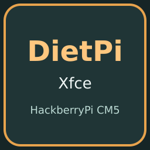

# DietPi Xfce for HackberryPi

Customized ARM64 **DietPi v10.8.2**, based on **Debian 13 Trixie**, with a preinstalled desktop for **HackberryPi CM5**.

- Preinstalled **Xfce/X11** desktop with LightDM password login.
- Default **900 × 900** workspace on the physical **720 × 720** DPI screen.
- English **Display Scale** desktop app, adjustable from **480 × 480** to **1080 × 1080**, with font antialiasing.
- HackberryPi screen, direct touchscreen, **USB 2.0 Host** and MAX17048 battery support.
- Top-right **Wi-Fi, Bluetooth, volume, battery and clock** controls. Wi-Fi uses NetworkManager; Bluetooth uses BlueZ/Blueman; audio uses PipeWire with PulseAudio compatibility.
- Genuine **Neofetch 7.1.0**; open a terminal and run `neofetch`.
- Login-screen hint: **Default Password: pi**.
- Automatic screensaver, blanking, DPMS, idle dimming and idle suspend disabled on AC and battery. Manual locking remains available.

Default username: **pi**. Default password: **pi**, both lowercase. Use `sudo` for administrator commands and change the password after first login. Connect your own Wi-Fi and Bluetooth devices; the public image excludes saved personal connections, pairings, account sessions and histories.

## Raspberry Pi Imager

Use the [Imager online catalog](https://raw.githubusercontent.com/DZT970525/Operating-System-for-HackberryPi/main/os_list_imager.json) and choose **HackberryPi CM5 → DietPi Xfce for HackberryPi**, or [download the complete image](https://github.com/DZT970525/Operating-System-for-HackberryPi/releases/download/dietpi-displayscale-hackberrypi-2026-11-13/DietPi-Trixie-Xfce-HackberryPi-CM5-DisplayScale-Neofetch-20261113.img.xz) and select it with **Use custom**. Choose the compressed `.img.xz` directly; manual decompression and merging are not needed.

Use a **16 GB or larger SD card**. Writing replaces the selected card. Let Imager finish writing and verification, insert the card in HackberryPi CM5, then boot. Read the [installation guide](../Imager/DietPi.md).

## Display Scale and desktop controls

The physical panel always remains **720 × 720 pixels**. Display Scale changes the software workspace: smaller numbers enlarge text and controls; larger numbers fit more content. Double-click **Display Scale**, drag and release the slider, then use **Save as default** to retain a selection. **Reset to 900** restores the factory workspace. No global desktop pinch-to-zoom service is included.

Click the Wi-Fi icon in the top-right panel to choose a network. Use the Bluetooth icon to open the native pairing manager. Click the volume icon for its slider and sound settings. The desktop **Wi-Fi Settings** shortcut opens the same graphical NetworkManager connection editor.

## First start and maintenance

The compact image expands its own root filesystem on first start and creates fresh machine and SSH identities. Allow preparation to finish. It does not repeat DietPi's desktop download/setup: Xfce and the desktop controls are already installed.

The native kernel is **6.18.60+rpt-rpi-2712**, with matching `linux-headers-rpi-2712` and the MAX17048 DKMS source. Keep native kernel, headers and boot files coherent when updating through DietPi/APT; a battery module must build successfully for a new kernel. This image uses Debian/APT trust, not a pacman initialization step.

## Validation

The owner accepted the configured source card for publication. Factory privacy and offline audit: **passed: fresh filesystems, private state excluded, factory account and retained integration checked**. Complete compressed/expanded image verification: **passed: native filesystem/offline checks and complete compressed-to-raw SHA-256 round-trip**. Standalone filesystem expansion: **passed using the shipped standalone growth helper in an isolated two-partition loop test; physical first boot remains pending**.

The rebuilt sanitized image has not received a separate physical flash/first-boot test. Physical Wi-Fi association, Bluetooth pairing, audio output and AC/battery idle/manual-lock testing remain separate from the offline checks. Source-card acceptance does not establish those final-image hardware tests.

## Checksums

| Artifact | Bytes | SHA-256 |
| --- | --- | --- |
| `DietPi-Trixie-Xfce-HackberryPi-CM5-DisplayScale-Neofetch-20261113.img.xz` | `618265540` | `83a3db22c72a385b99a11c1bbf1b949e810691423811fb743b60f8484f8e9211` |
| Expanded `.img` | `4204789760` | `f732fb5b2dad3ec2a19d37d85a69e9f102acbdb2355e000d45a1ef1640c1e0a9` |

Release: [dietpi-displayscale-hackberrypi-2026-11-13](https://github.com/DZT970525/Operating-System-for-HackberryPi/releases/tag/dietpi-displayscale-hackberrypi-2026-11-13). `SHA256SUMS`, `factory-status.json` and `image-verification.json` accompany the image.

## PINN

This release is a **standalone Raspberry Pi Imager image**. It has no DietPi PINN entry or tested PINN partition adapter. The six existing PINN systems keep their current feed and installation method. A complete `.img.xz` is not a PINN filesystem archive.

## Sources and notices

The [integration source archive](https://github.com/DZT970525/Operating-System-for-HackberryPi/releases/download/dietpi-displayscale-hackberrypi-2026-11-13/DietPi-HackberryPi-Integration-Source-20261113.tar.gz) contains the actual screen/touch overlay description, MAX17048 driver and DKMS files, Display Scale app, no-idle configuration, USB Host setup, desktop-tray/network integration, standalone growth/identity helpers and original pinned Neofetch source. The [source-notices archive](https://github.com/DZT970525/Operating-System-for-HackberryPi/releases/download/dietpi-displayscale-hackberrypi-2026-11-13/DietPi-HackberryPi-Source-Notices-20261113.tar.gz) retains upstream licenses, base-image provenance and the native package source inventory.

The matching native Debian/Raspberry Pi kernel source package is **`linux 1:6.18.60-1+rpt1`**. Its three original source artifacts are attached to this Release: [linux_6.18.60.orig.tar.xz](https://github.com/DZT970525/Operating-System-for-HackberryPi/releases/download/dietpi-displayscale-hackberrypi-2026-11-13/linux_6.18.60.orig.tar.xz), [linux_6.18.60-1+rpt1.debian.tar.xz](https://github.com/DZT970525/Operating-System-for-HackberryPi/releases/download/dietpi-displayscale-hackberrypi-2026-11-13/linux_6.18.60-1%2Brpt1.debian.tar.xz), [linux_6.18.60-1+rpt1.dsc](https://github.com/DZT970525/Operating-System-for-HackberryPi/releases/download/dietpi-displayscale-hackberrypi-2026-11-13/linux_6.18.60-1%2Brpt1.dsc). Their SHA-256 values were checked against the authenticated Raspberry Pi APT source index; the complete original and Debian patch archives were fully decoded and scanned. These are the matching Debian/RPi sources, not an Arch Linux ARM repack.

Native package copyrights remain under `/usr/share/doc`. This independently maintained HackberryPi customization is based on [DietPi](https://dietpi.com/) and [Debian](https://www.debian.org/); it is not an official DietPi project image. DietPi management scripts retain their GPL-2.0 license.
