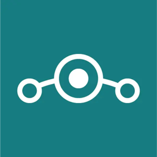

# LineageOS 24.0 / Android 17 for HackberryPi CM5

An **unofficial, noncommercial community adaptation** of [KonstaKANG’s Raspberry Pi 5 / CM5 build](https://konstakang.com/devices/rpi5/LineageOS24/), dated 2026-10-16. This project is not affiliated with or endorsed by KonstaKANG, LineageOS, Mozilla or the Raspberry Pi Foundation.

[Download the complete image and matching sources](https://github.com/DZT970525/Operating-System-for-HackberryPi/releases/tag/lineageos-displayscale-hackberrypi-2026-11-16) · [Raspberry Pi Imager installation guide](../Imager/LineageOS.md) · [Licenses and sources](SOURCES.md)

## Included adaptation

- **900 × 900 logical workspace** by default, with the original **720 × 720** DPI panel timing. The English **Display Scale** desktop app offers **480–1080**, one step at a time. Move the slider or choose a preset, then press **Apply**; **Restore Default 900** returns to the starting scale. This changes the workspace scale, not the physical screen resolution.
- Native screen and touch configuration, USB 2.0 **Host** support for the external keyboard, Wi-Fi and Bluetooth controls.
- **MAX17048 battery percentage**, refreshed about every three seconds. Charging state is estimated; this bridge does not replace the full Android Health HAL or claim accurate temperature/current readings.
- **Volume** in Android’s top Quick Settings, alongside Wi-Fi and Bluetooth. Swipe down to open it; no floating volume button is used.
- Official, unmodified **Firefox 160.0** with its matching native libraries, and a separate Baidu/Bilibili web-link handler. See the [Firefox update instructions](../Imager/LineageOS.md#firefox-updates).
- Official **Termux 0.118.3** and genuine **Neofetch 7.1.0**, prepared locally without a network download. Open Termux and run `neofetch`.
- Automatic idle screensaver and long-idle display blanking disabled to avoid unwanted DPI-panel transitions. The power button remains available.

## First start and privacy

This image starts Android’s own setup wizard. Choose your own network, account and optional screen lock. **There is no Linux `pi / pi` login or preset Android lock-screen password.** After completing setup, allow first-start preparation to finish. Display Scale and Firefox are available in the launcher; the factory setup also adds desktop shortcuts.

The release replaces **all user data and Android metadata** with a pristine factory baseline. It contains no saved Wi-Fi passwords, Bluetooth pairings, accounts, browser history, cookies, Termux home/history, authorized ADB keys or previous owner settings. The owner’s tested card is retained unchanged.

## Validation and scope

The owner boot-tested and accepted the configured hardware/app version before packaging. The publication copy keeps the accepted boot/system components and rebuilds empty data with ordered factory provisioning. Filesystem, partition, application/native-library hashes, privacy boundaries and full compressed-image integrity are checked offline. **The newly sanitized image has not yet received a separate physical flash/first-run test.**

This is a standalone whole-card image for **Raspberry Pi Imager**, not a PINN filesystem package. It is intended for HackberryPi **CM5** with the matching 720 × 720 panel and wiring. Stock whole-image Android updates may replace the custom hardware integration; retain a backup and use an adapted release when available.

## Credits and licensing

The base build, Raspberry Pi device work and KonstaKANG scripts remain credited to their upstream authors. Covered KonstaKANG components and adaptations are distributed under **CC BY-NC-SA 4.0**, for **noncommercial use only**, with attribution and ShareAlike; the kernel, Android, firmware, Firefox, Termux and other components retain their own licenses. New independent HackberryPi helper sources are MIT. No single license covers the complete image. See [SOURCES.md](SOURCES.md), the bundled notices and the accompanying source archive for exact source references and the change list.
