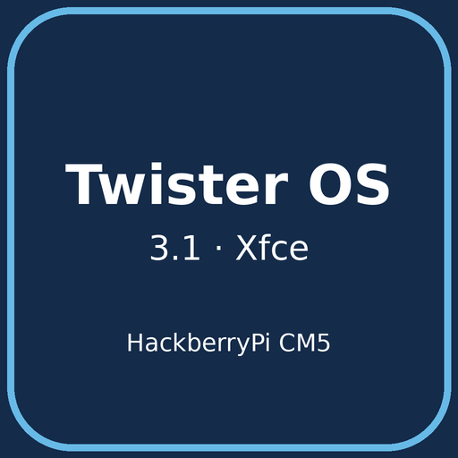

# Twister OS 3.1.0 Xfce for HackberryPi

Customized ARM64 **Twister OS 3.1.0**, based on **Debian 12 Bookworm**, with **Xfce/X11 preinstalled** for **HackberryPi CM5**.

- Default **900 × 900** workspace on the native **720 × 720** DPI panel.
- English **Display Scale** desktop application for **480–1080**, saved defaults and font antialiasing.
- Screen/touch, **USB 2.0 Host**, MAX17048 battery support and genuine **Neofetch 7.1.0**.
- Native **NetworkManager Wi-Fi**, **BlueZ/Blueman Bluetooth**, **PulseAudio volume** and battery controls. Their panel position follows the selected Twister theme.
- **ThemeTwister** with all 15 theme choices adapted to set the DPI screen's matching wallpaper, including Windows XP. Theme changes flush settings and use normal logout.
- **Default Password: pi** login hint. Automatic screensaver, blanking, DPMS, idle dimming and idle suspend are disabled; manual locking remains available.

Default username: **pi**. Default password: **pi**, both lowercase. Use `sudo` for administrator commands and change the password after first login. Configure your own networks and accounts; saved personal connections, pairings, sessions and histories are excluded from the public copy.

## Raspberry Pi Imager

Use the [automatic download-and-merge helper ZIP](https://github.com/DZT970525/Operating-System-for-HackberryPi/releases/download/twisteros-displayscale-hackberrypi-2026-11-16/TwisterOS-Imager-Download-Tools-20261116.zip) to download **16 parts**, verify them and create the complete **`TwisterOS-3.1.0-Xfce-HackberryPi-CM5-DisplayScale-Neofetch-20261116.img.xz`**. Then select that file through **Use custom** in Raspberry Pi Imager. Windows, macOS and Linux launchers are included; interrupted downloads can resume. Manual decompression and manual merge commands are not needed.

Use a **16 GB or larger SD card**. Writing replaces the selected card. Let writing and verification finish before booting. Keep Imager's OS customization disabled for this preconfigured image. Read the [installation guide](../Imager/TwisterOS.md).

## Scaling and themes

The physical panel remains **720 × 720 pixels**. Display Scale adjusts the software workspace: smaller numbers enlarge text and controls, and larger numbers fit more content. Open **Display Scale** on the desktop, drag and release its slider or choose a preset, then select **Save as default**. **Reset to 900** restores the factory setting. No global desktop pinch-to-zoom daemon is included.

Open **ThemeTwister** to change the desktop appearance. Its theme wallpapers now follow the actual DPI screen across four workspaces. The native menus, fonts, panel plugin order and theme assets are preserved; panel placement changes with the selected theme. Save your work before accepting a theme change's session restart.

Click the native Wi-Fi icon to choose a network, use Blueman to pair/connect devices, and use the volume icon or `pavucontrol` for sound. Run `neofetch` in a terminal for system information.

## First start and maintenance

The compact image expands its root filesystem and creates fresh machine and SSH identities on first start. Allow this preparation to finish. Xfce and the hardware/desktop controls are already installed; configure your own networks after logging in.

The native RP1 DPI output configuration from the accepted boot-tested system is retained. The retained native kernel is **6.12.25+rpt-rpi-v8**, with matching headers, MAX17048 DKMS source and a matching `initramfs8`. Keep the native kernel, headers and firmware boot files coherent during upgrades. The prepared v8 kernel uses 4 KiB pages; it must not be mixed with modules for the 16 KiB `rpi-2712` flavour.

## Validation and checksums

The owner accepted the configured source card for publication. The sanitized image passed private-state exclusion, native filesystem/integration checks, complete XZ compressed-to-raw SHA-256 verification, and an isolated test of its shipped root-expansion helper.

The final sanitized image has not received a separate physical flash/first-boot test. Actual wireless association, Bluetooth pairing and audio output on that final copy remain separate from the offline checks.

| Artifact | Bytes | SHA-256 |
| --- | --- | --- |
| `TwisterOS-3.1.0-Xfce-HackberryPi-CM5-DisplayScale-Neofetch-20261116.img.xz` | `2321279728` | `5548c40f709f0212d65ff803de08c72c13e356d75a2dfb7d59702591f25a08e0` |
| Expanded `.img` | `11253317632` | `faeeb2eded19cbf5ba8ecb433bcf5ae79001fb817537b9b78d2d8046e1a86216` |

Release: [twisteros-displayscale-hackberrypi-2026-11-16](https://github.com/DZT970525/Operating-System-for-HackberryPi/releases/tag/twisteros-displayscale-hackberrypi-2026-11-16). `SHA256SUMS`, `factory-status.json` and `image-verification.json` accompany the download.

## PINN and sources

This release is **standalone for Raspberry Pi Imager**; no Twister OS PINN package is added. The existing PINN feed remains available for its listed systems. A complete disk image is not a PINN filesystem archive.

The [integration source archive](https://github.com/DZT970525/Operating-System-for-HackberryPi/releases/download/twisteros-displayscale-hackberrypi-2026-11-16/TwisterOS-HackberryPi-Integration-Source-20261116.tar.xz), source-notices archive and exact native kernel sources are linked in [SOURCES.md](SOURCES.md). Original component notices remain in the image. This is an independent customization of [Twister OS by Pi Labs](https://twisteros.com/); it is not an official Pi Labs, Debian or Raspberry Pi release.
